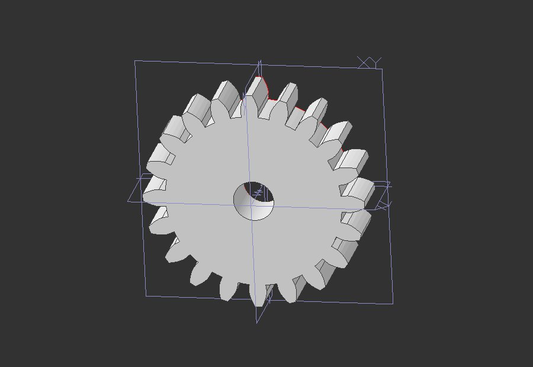

# Alibre Design on Linux: Progress

A public progress report on running the Windows version of
[Alibre Design](https://www.alibre.com/) on Linux through [Wine](https://www.winehq.org/).



**Read the report:** open `index.html`, or the GitHub Pages site once it is turned on
(see below).

## Status at a glance

| Area | Progress |
|---|---|
| Installation and license activation | 100% |
| User interface | 95% |
| Part modeling and 3D view | 85% |
| Automation and file conversion | 95% |
| Server deployment | 90% |
| Add-ons | 60% |
| Drawings, printing and other workspaces | 20% |
| Packaging for others | 10% |

Percentages are estimates, not measured test coverage. Last updated November 25, 2026.

## Updating the report

The whole report is one file, `index.html`, with no build step.

1. **Progress numbers.** Each area is one line in the "Progress by area" section:
   ```html
   <div class="g done" style="--pct:85"> ...
   ```
   Change the `--pct` value. The bar and the percentage text both follow it.
   Add or remove `done` to switch the bar between green (on track) and blue (in progress).
2. **Overall ring.** Change `--pct` on `<div class="ring" style="--pct:70" ...>`,
   and the number in its `aria-label`.
3. **Date and status.** Update the title block at the top (`Date`, `Status`)
   and the "Last updated" line in this README.
4. **Milestones, Working today, Next.** Plain lists; edit the text.
5. **Images.** Put them in `assets/` and reference them with a relative path.
6. Add a line to `CHANGELOG.md`, then commit and push. GitHub Pages redeploys
   on its own within a minute or two.

Keep this report general: no host names, addresses, account names, file names,
patch code or other internal details. Those belong in the private report.

## Publishing with GitHub Pages

In the repository on GitHub: **Settings → Pages → Build and deployment → Deploy from
a branch**, branch `main`, folder `/ (root)`. Or from a terminal:

```bash
gh api -X POST repos/OWNER/REPO/pages -f "source[branch]=main" -f "source[path]=/"
```

The site appears at `https://OWNER.github.io/REPO/`.

## Disclaimer

An independent community project. Not affiliated with, endorsed by, or supported by
Alibre, LLC or the WineHQ project. Alibre Design is a trademark of its owner. Each user
needs their own Alibre Design license and installs it from the official installer.
